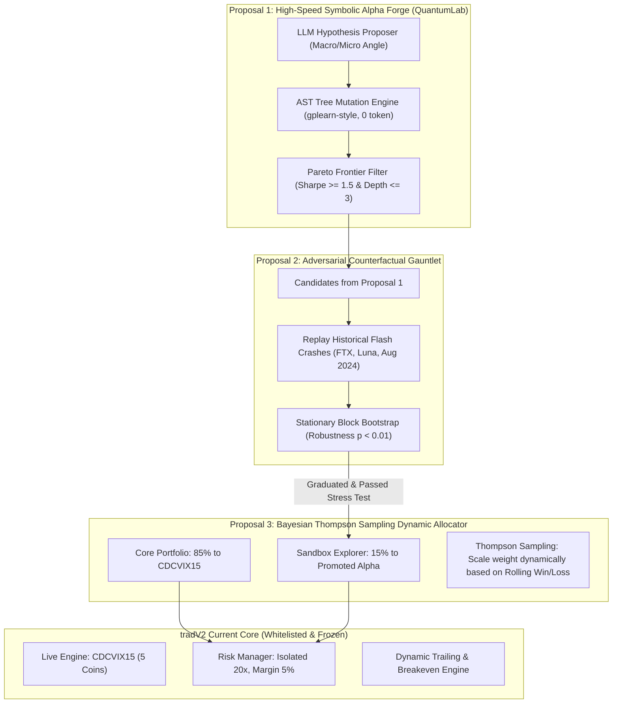

# รายงานการวิเคราะห์และคลังความรู้วิวัฒนาการตัวเองของระบบเทรด (Autonomous Evolution & Self-Adaptive Quant Systems Compendium)
**เวอร์ชัน:** 1.0 (ตุลาคม 2026)  
**สถานะ:** บันทึกความรู้สถาปัตยกรรมมาตรฐานและแผนงานอนาคต (`.agents/knowledge/AUTONOMOUS_EVOLUTION_COMPENDIUM.md`)  
**เป้าหมาย:** ประเมินระดับวิวัฒนาการปัจจุบันของ tradV2 เทียบกับมาตรฐานสากล ค้นคว้างานวิจัยระดับโลก (GitHub, Hugging Face, arXiv) บันทึกบทเรียน และเสนอไอเดียต่อยอดที่คุ้มค่าสูงสุด (High ROI) โดยไม่ซ้ำซ้อนกับระบบเดิม

---

## 1. การประเมินระดับวิวัฒนาการของระบบ (Autonomous Evolution Maturity Scale)

เพื่อประเมินความสามารถในการปรับตัวและวิวัฒนาการตัวเองของระบบเทรดเชิงปริมาณ เราใช้เกณฑ์ **6-Level Quant Autonomous Evolution Framework**:

| ระดับ (Level) | คำนิยามทางสถาปัตยกรรม | กลไกการตัดสินใจและการเรียนรู้ | ตัวอย่างในวงการ | สถานะใน tradV2 |
| :--- | :--- | :--- | :--- | :--- |
| **L0: Manual** | การเทรดด้วยดุลยพินิจของมนุษย์ 100% | อารมณ์, ข่าวสาร, การดูกราฟสด | เทรดเดอร์ทั่วไป | ก้าวข้ามแล้ว |
| **L1: Static Rule-Based** | รันบอทอัตโนมัติตามเงื่อนไขคงที่ | ตัวชี้วัดเทคนิคัลตายตัว (MA Cross, Fixed SL/TP) | EA ทั่วไป, tradV1 | ก้าวข้ามแล้ว |
| **L2: Model-Driven & Gates** | มี ML กรองสัญญาณ + Risk Engine ปรับตัวตามตลาด | Classifier กรองความน่าจะเป็น, ATR Dynamic Stops, Breakeven/Trailing | ML Entry Filter, tradV2 ยุคแรก | ก้าวข้ามแล้ว |
| **L3: Adaptive Multi-Agent & Shadow Sandbox** | **มีสภา Agent วิเคราะห์ข้อผิดพลาด และแล็บวิจัยจำลองสูตรคู่ขนาน** | Meta-Prompt Mutation, Safe AST Sandbox, Dynamic Risk Sizing, Sandbox Graduation Gate | Hedge Funds ขนาดกลาง | **👉 tradV2 ปัจจุบัน (ระดับ 3.2)** |
| **L4: Closed-Loop Self-Evolving System** | **ระบบสร้าง ทดสอบ คัดสรร และจัดสรรเงินทุนสู่กลยุทธ์ใหม่ได้เองอย่างปลอดภัย** | Symbolic Tree Mutation, Bayesian Bandit Allocation, Counterfactual Stress Replay | Microsoft RD-Agent, AlphaGen, Renaissance (บางส่วน) | **🎯 เป้าหมายถัดไป** |
| **L5: Self-Transcending General Quant** | ปรับแก้โครงสร้างโค้ด สถาปัตยกรรม และไปป์ไลน์ข้อมูลได้เองโดยสมบูรณ์ | Autonomous Code Re-architecture, Self-Directed Cross-Market Arbitrage | AGI / Superaligned Quant Swarm | ขั้นทฤษฎีในอนาคต |

### การวิเคราะห์สถานะปัจจุบันของ tradV2 (ประเมินที่ระดับ 3.2):
* **สิ่งที่ทำได้ดีแล้ว (Core Strengths):**
  1. **Two-World Paradigm**: แยกโลก Live Execution (Code Freeze) ออกจาก Research Sandbox (QuantumLab) ป้องกันไม่ให้โมเดลทดลองทำลายเงินทุนจริง
  2. **Safe Mathematical AST DSL**: มีกลไกตรวจสอบความปลอดภัยของนิพจน์คณิตศาสตร์ 28 Features ป้องกัน Code Injection และหักต้นทุนค่าฟี 0.30% ทุกไม้
  3. **Multi-Agent Council & Error Taxonomy**: มี Arbiter, Specialists, Contrarian Scout และการวิเคราะห์ MAE/MFE Drag
  4. **Strict Graduation Gate**: มี `CouncilPromotionEvaluator` ตั้งเกณฑ์ 10 ไม้, PF $\ge 1.45$, Win Rate $\ge 48\%$ ก่อนขยับขั้น
* **คอขวดที่ขัดขวางไม่ให้ก้าวสู่ระดับ 4 (Current Bottlenecks):**
  1. *Prompt-to-Expression Search Inefficiency*: การพึ่งพา LLM คิดค้น String Expression ใน `prompt_evolution.py` มีความแปรปรวนสูง เปลือง Token และสำรวจพื้นที่คณิตศาสตร์ได้แคบ
  2. *All-or-Nothing Strategy Allocation*: ระบบ Live ผูกติด `CDCVIX15` ตัวเดียว หากมีอัลฟ่าใหม่ผ่าน Sandbox ระบบยังไม่มีกลไก "ค่อยๆ จัดสรรเงินทุนแบบไดนามิก (Dynamic Capital Router)"
  3. *Unsupervised Regime Blindness*: ระบบใช้ Threshold ของอินดิเคเตอร์เดี่ยว (Squeeze Ratio, ATR) แต่ขาดการจัดกลุ่มสภาวะตลาดแบบองค์รวม (Macro Market Regime)
  4. *Lack of Synthetic Adversarial Stress Testing*: ขาดการทดสอบสูตรกับวิกฤติตลาดในอดีต (Flash Crash Replay) ก่อนปล่อยเข้า Sandbox

---

## 2. การสำรวจงานวิจัยและโครงการระดับโลก (State-of-the-Art Research & Repositories)

จากการค้นคว้างานวิจัยล่าสุด (2024-2026) ทั้งบน GitHub, Hugging Face, และ arXiv พบโครงการที่มีศักยภาพสูงในการนำมาประยุกต์ใช้กับ tradV2:

### 2.1 ด้านการขุดค้นสูตรอัลฟ่าอัตโนมัติ (Automated Alpha Mining & Evolution)
1. **Microsoft RD-Agent (`microsoft/RD-Agent`)**
   * *ประเภท:* GitHub Open-Source Framework (Microsoft Research)
   * *จุดเด่น:* มีโมดูล **RD-Agent(Q)** ออกแบบมาเพื่อ Quant Finance โดยเฉพาะ ใช้ระบบ **Co-STEER** แบ่งขั้นตอนเป็น Research (ตั้งสมมติฐาน) $\rightarrow$ Development (แปลงเป็นสูตรโค้ด) $\rightarrow$ Evaluation (แบ็กเทสต์และวัด Rank IC) อย่างเป็นวงจรปิด
   * *บทเรียนสำหรับ tradV2:* ควรแยกบทบาท Agent ให้ชัดเจนว่าตัวไหนเป็นผู้เสนอแนวคิด (Hypothesis Proposer) และตัวไหนเป็นผู้แปลงสูตรคณิตศาสตร์ (Formula Compiler)
2. **AlphaGen (`ICT-FinD-Lab/alphagen`)**
   * *ประเภท:* GitHub Repository & Paper (KDD 2023)
   * *จุดเด่น:* ค้นหาสูตร **Formulaic Alphas ผ่าน Genetic Programming (GP) และ Reinforcement Learning** โดยใช้โครงสร้าง Expression Trees ที่ต่อยอดจาก `gplearn` และ Deep Symbolic Optimization (DSO) มุ่งเน้นการหาชุดอัลฟ่าที่เสริมฤทธิ์กัน (Synergy) ไม่ซ้ำซ้อน
   * *บทเรียนสำหรับ tradV2:* การกลายพันธุ์สูตรคณิตศาสตร์ใน QuantumLab ไม่จำเป็นต้องพึ่ง LLM ยิง Token ทุกครั้ง การใช้ Symbolic Tree Crossover/Mutation ในหน่วยความจำสามารถสร้างและทดสอบ 10,000 สูตรได้ภายในไม่กี่วินาทีโดยไม่มีค่าใช้จ่าย

### 2.2 ด้าน Agent เทรดแบบวิวัฒนาการตัวเอง (Self-Evolving Trading Agents)
1. **EvolveTrade: Experience-Driven Policy Refinement (arXiv:2609.17632)**
   * *ประเภท:* งานวิจัย arXiv (กันยายน 2026)
   * *จุดเด่น:* มอง System Prompt และนโยบายการใช้เครื่องมือของ Agent เป็น **Text-Parameterized Policy** เมื่อ Agent เทรดและได้รับผลลัพธ์พอร์ตจริง (Realized PnL, Drawdown, Slippage) ตัว Policy Agent จะนำ Execution Traces มาปรับปรุงคำแนะนำและเกณฑ์การควบคุมความเสี่ยงของ Agent ในรอบถัดไปแบบวนลูป
   * *บทเรียนสำหรับ tradV2:* นำมาปรับใช้กับ `daily_debrief.py` และ `prompt_evolution.py` โดยให้ Agent สกัด "กฎประจำสัปดาห์ (Weekly Operational Heuristics)" จากไม้ที่แพ้ แทนที่จะแก้แค่สูตรตัวเลข
2. **SEMA & Meta-Team (arXiv:2603.23875, arXiv:2605.29790)**
   * *ประเภท:* สถาปัตยกรรม Multi-Agent Collaborative Evolution (2026)
   * *จุดเด่น:* การแลกเปลี่ยนหลักฐานระหว่าง Agent หลังจบงาน (Post-Task Evidence Exchange) เพื่ออัปเดตองค์ความรู้แบบ Topological State Tracking ป้องกันปัญหา Agent แต่ละตัวตัดสินใจขัดแย้งกัน

### 2.3 ด้านโมเดลพยากรณ์ความผันผวนระดับรากฐาน (Foundation Models on Hugging Face)
1. **Salesforce Moirai 2.0 (`Salesforce/moirai-2.0-R-small`)**
   * *ประเภท:* Time Series Foundation Model บน Hugging Face (Decoder-Only Architecture)
   * *จุดเด่น:* ใช้ Quantile Loss ทำการพยากรณ์แบบ Zero-Shot Probabilistic Forecasting รวดเร็วและใช้แรมน้อยกว่ารุ่นแรกอย่างมหาศาล
   * *บทเรียนสำหรับ tradV2:* **ห้ามใช้ทำนายราคาปิด** แต่นำมาใช้ประเมิน **Volatility Cone (กรอบความผันผวน 24 ชั่วโมงข้างหน้า)** เพื่อกำหนดขนาดระยะ Trailing Stop และ Stop Loss ให้สอดคล้องกับพายุความผันผวน
2. **TS2Vec (Towards Universal Representation for Time Series)**
   * *ประเภท:* Unsupervised Contrastive Learning for Time Series
   * *จุดเด่น:* เปลี่ยนข้อมูลแท่งเทียนเป็น Representation Vector (Embedding) โดยไม่ต้องใช้ Label เพื่อจัดกลุ่ม Market Regime (Chop vs Trend vs Capitulation)

---

## 3. บทเรียนและหลักการสำคัญเพื่อป้องกันความล้มเหลว (Core Lessons & Anti-Patterns)

1. **กฎแห่งการประหยัด Token และความเร็ว CI (The Token & Latency Law)**
   - *บทเรียน:* การเรียก LLM API บ่อยเกินไปในลูป 15m Polling ทำให้เกิดค่าใช้จ่ายสูงและเสี่ยงต่อ Network Timeout ใน GitHub Actions
   - *ข้อสรุป:* กระบวนการวิวัฒนาการตัวเอง (Heavy Research & Evolution) ต้องรันแบบ **Asynchronous / Weekly Scheduled Job** แยกจาก Live Polling อย่างเด็ดขาด
2. **กับดักความซับซ้อนของสูตร (Bloat & Overfitting Trap)**
   - *บทเรียน:* การปล่อยให้ระบบค้นหาสูตรคณิตศาสตร์แบบเปิดอิสระ มักนำไปสู่นิพจน์ที่ยาวเป็นกิโลเมตร (`ts_corr(close, 20) * ts_std(...) + ...`) ซึ่งเข้าข่าย Curve Fitting
   - *ข้อสรุป:* ต้องใช้หลักการ **Occam's Razor & Complexity Penalty (BIC/AIC)** จำกัดความลึกของ Expression Tree ไม่เกิน 3-4 ชั้น
3. **การแยกบทบาทความเสี่ยง (Principle of Orthogonal Safety)**
   - *บทเรียน:* ไม่ว่าโมเดลจะพัฒนาตัวเองไปฉลาดแค่ไหน ตัวควบคุมความเสี่ยง (Circuit Breaker, Dynamic Sizing, Max Drawdown) ต้องเป็น **Hard Boundary ใน Python Code ที่ไม่มี AI ตัวใดเข้าไปแก้ไขได้ (Immutable Guardrails)**

---

## 4. ข้อเสนอ 3 ไอเดียพัฒนาที่คุ้มค่าสูงสุด (High-ROI, Non-Redundant Proposals)

ข้อเสนอทั้ง 3 ข้อนี้ได้รับการออกแบบให้ **ไม่ทับซ้อนกับระบบที่มีอยู่เดิม** และ **ไม่ทำลายระบบ Serverless ที่เบาและรวดเร็ว**:

### ไอเดียที่ 1: "GP-Tree Symbolic Mutator" สำหรับ QuantumLab (คุ้มค่า: สูงมาก | ต้นทุน: ฟรี)
* **ปัญหาเดิม:** `prompt_evolution.py` พึ่งพา LLM คิดค้น String Expression ซึ่งได้สูตรซ้ำๆ และเปลืองโควตา Token
* **แนวทางใหม่:** สร้างโมดูล **Symbolic Tree Operator** ใน `infrastructure/council/quantum_lab.py` ที่นำคุณสมบัติ 28 ตัวแปรมาสับเปลี่ยนแบบ Expression Tree (Crossover & Node Mutation) ใน RAM
  - ทำงานได้ 5,000 รอบในเวลาเพียง 2 วินาที (Zero Token Cost)
  - นำ LLM มาใช้เฉพาะขั้น **ตั้งสมมติฐาน (Prompt Seed)** ในระดับชั้นบนสุดเท่านั้น
  - คัดกรองด้วย **Pareto Frontier**: เลือกสูตรที่ให้ Net Expectancy สูงสุด ภายใต้ความซับซ้อนของต้นไม้ที่สั้นที่สุด

### ไอเดียที่ 2: "Adversarial Stress Gauntlet" ตัวทดสอบต้านวิกฤต (คุ้มค่า: สูงมาก | เสี่ยงเงินจริง: 0)
* **ปัญหาเดิม:** ปัจจุบันเมื่อสูตรผ่าน QuantumLab ระบบจะส่งเข้า Sandbox เพื่อรอเทรดจริง 10 ไม้ หากสภาวะตลาดช่วงนั้นเรียบง่าย แต่อยู่ดีๆ เกิด Black Swan อัลฟ่าใหม่อาจพังทลาย
* **แนวทางใหม่:** สร้างสคริปต์ `tools/run_alpha_stress_gauntlet.py`
  - นำ Candidate Formula ไปยิงทดสอบย้อนหลังบนแท่งเทียน 15m ช่วงเกิด **Flash Crash สำคัญ 3 เหตุการณ์** (FTX Collapse พ.ย. 2022, Luna Death Spiral พ.ค. 2022, และ Black Monday ส.ค. 2024)
  - นำไปผ่าน **Stationary Block Bootstrapping** สลับแท่งเทียน 1,000 ชุดเพื่อดูว่าผลกำไรเกิดจากโชคช่วยหรือไม่
  - สูตรที่จะผ่านเข้า Sandbox ได้ ต้องมี Max Drawdown ในช่วงวิกฤตไม่เกินเกณฑ์ที่กำหนด

### ไอเดียที่ 3: "Bayesian Thompson Sampling Dynamic Allocator" (คุ้มค่า: สูงมาก | ปลอดภัย 100%)
* **ปัญหาเดิม:** ปัจจุบันระบบ Live เทรดได้เฉพาะ `CDCVIX15` ตัวเดียวแบบ All-or-Nothing หากอนาคตมีกลยุทธ์ใหม่ผ่านเกณฑ์ Sandbox เราไม่มีวิธีจัดสรรเงินทุนอย่างค่อยเป็นค่อยไป
* **แนวทางใหม่:** ใช้หลักการ **Multi-Armed Bandit (Bayesian Thompson Sampling)** ใน `risk_manager.py`:
  - จัดสรรเงินทุนแบ่งเป็น 2 กอง: **Core Capital (85%)** สำหรับ `CDCVIX15` และ **Explorer Capital (15%)** สำหรับ Promoted Strategy ตัวใหม่
  - ขนาดไม้ของตัวใหม่จะเริ่มต้นที่ขนาดเล็กมาก (Micro-lot 20-30 USDT)
  - ทุกครั้งที่ตัวใหม่ทำกำไร Probability Distribution ของผลตอบแทนจะขยับขึ้น ทำให้น้ำหนักค่อยๆ เพิ่มขึ้นอัตโนมัติ หากเริ่มมีสัญญาณ Decay หรือแพ้ติดกัน 2 ไม้ ระบบจะลดน้ำหนักเหลือ 0% ทันทีโดยไม่กระทบพอร์ตหลัก

---

## 5. สรุปแผนปฏิบัติการและแนวทางนำไปประยุกต์ใช้จริง (Next Concrete Steps)

1. **ระยะสั้น (Immediate):**
   - รักษาความเสถียรของ Live Core (`CDCVIX15` บน 5 เหรียญหลัก) ให้ทำงานต่อไปโดยไม่แตะต้อง
   - บันทึกคลังความรู้นี้ไว้ในระบบเพื่อเป็นคู่มือมาตรฐานสำหรับนักพัฒนาและ Agent
2. **ระยะกลาง (Milestone Next):**
   - พัฒนาฟังก์ชัน Expression Tree Crossover/Mutation เล็กๆ เสริมใน QuantumLab เพื่อช่วยคิดค้นสูตรคู่ขนานโดยไม่ต้องพึ่งพา LLM Token ตลอดเวลา
   - รวบรวมข้อมูลแท่งเทียน M15 ของช่วงวิกฤติตลาดสำคัญ (Flash Crash Samples) จัดเก็บไว้ในโฟลเดอร์ `.data/historical_stress_events/` สำหรับใช้เป็น Adversarial Gauntlet
3. **ระยะยาว (Production Scale):**
   - เมื่อมีอัลฟ่าที่ผ่านเกณฑ์ทดสอบใน Sandbox ครบ 10 ไม้ ค่อยเริ่มเปิดใช้ Thompson Sampling Dynamic Allocator ในสัดส่วน 10-15% เพื่อให้ระบบวิวัฒนาการตัวเองได้อย่างสมบูรณ์ในระดับ 4
