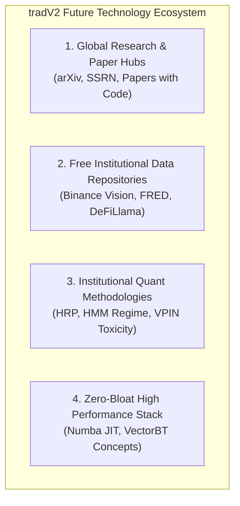
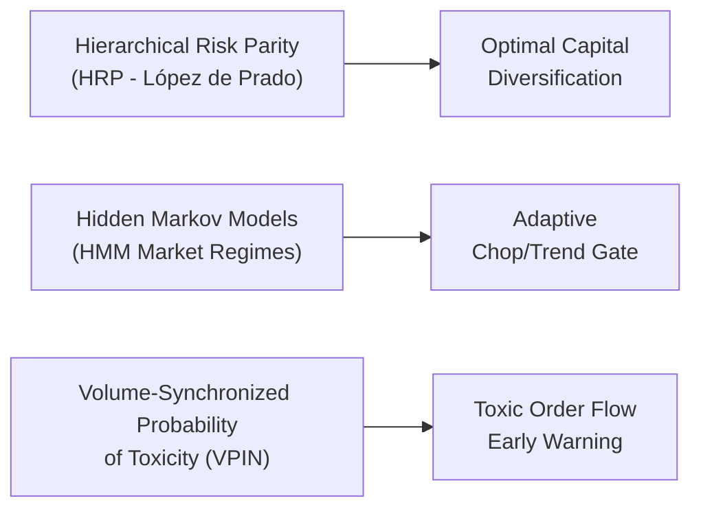

# สารบัญระบบวิจัยและคลังเทคโนโลยีระดับโลกสำหรับอนาคต (Global Quant Research & Technology Directory)
**เวอร์ชัน:** 1.0 (ตุลาคม 2026)  
**สถานะ:** บันทึกสารบัญเทคโนโลยีและแหล่งความรู้อ้างอิงหลัก (`.agents/knowledge/FUTURE_RESEARCH_AND_TECH_DIRECTORY.md`)  
**วัตถุประสงค์:** รวบรวมแหล่งงานวิจัยระดับโลก ฐานข้อมูลสถิติฟรี (Institutional Data APIs) ไลบรารีคณิตศาสตร์ และระเบียบวิธีวิจัยชั้นนำ เพื่อเป็นคลังข้อมูลอ้างอิงให้ระบบ `Global Horizon Scout`, QuantumLab และนักพัฒนาในอนาคตสามารถหยิบมาต่อยอดได้ทันทีโดยไม่ต้องเริ่มค้นหาจากศูนย์

---



---

## 1. แหล่งคลังงานวิจัยและเปเปอร์วิชาการระดับโลก (Research & Paper Hubs)
*(แหล่งค้นคว้าทฤษฎีและสมมติฐานใหม่ที่ `Global Horizon Scout` ใช้เป็นเป้าหมาย)*

| แหล่งงานวิจัย | ลิงก์ / การเข้าถึง | สาขาที่เกี่ยวข้องกับ tradV2 | แนวทางการนำมาต่อยอด |
| :--- | :--- | :--- | :--- |
| **arXiv: Quantitative Finance (`q-fin`)** | [`arxiv.org/archive/q-fin`](https://arxiv.org/archive/q-fin) | • `q-fin.ST` (Statistical Finance)<br>• `q-fin.TR` (Trading & Market Microstructure)<br>• `q-fin.PM` (Portfolio Management) | ติดตามเปเปอร์เกี่ยวกับโมเดลพยากรณ์ความผันผวน, การตรวจจับ Order Flow Imbalance, และอัลกอริทึมจัดการความเสี่ยง |
| **SSRN (Social Science Research Network)** | [`ssrn.com/en/index.cfm/fen`](https://www.ssrn.com/) | Financial Economics Network (FEN), Quantitative Trading Papers | แหล่งรวมเปเปอร์จากสถาบันชั้นนำ (เช่น Two Sigma, AQR, Man Group, Oxford, Stanford) |
| **Papers with Code (Time Series Hub)** | [`paperswithcode.com/task/time-series`](https://paperswithcode.com/task/time-series) | Time Series Anomaly Detection, Probabilistic Forecasting, Regime Clustering | ค้นหาโมเดลที่มี Source Code บน GitHub ให้ดาวน์โหลดและสกัดเป็นสูตรคณิตศาสตร์ทันที |
| **Hugging Face Time-Series Hub** | [`huggingface.co/models?pipeline_tag=time-series-forecasting`](https://huggingface.co/models?pipeline_tag=time-series-forecasting) | Foundation Models: Chronos, TimesFM, Moirai, PatchTST, MOMENT, UniTS | นำโครงสร้าง Quantile Loss ($q_{10}, q_{50}, q_{90}$) มาใช้ทำ Volatility Cone โดยไม่ต้องรันโมเดลหนัก |

---

## 2. ฐานข้อมูลสถิติและโครงสร้างตลาดฟรี 100% (Free Institutional Data APIs)
*(แหล่งข้อมูลระดับสถาบันที่เปิดให้ดึงฟรีโดยไม่ต้องเสียค่าบริการรายเดือนแพงๆ)*

### 2.1 Binance Public Vision Archive (`data.binance.vision`)
* **ลักษณะ:** คลังข้อมูลดิบอย่างเป็นทางการของ Binance เปิดให้ดาวน์โหลดฟรีแบบย้อนหลังรายวัน/รายเดือน
* **ข้อมูลที่มีประโยชน์ต่อ tradV2:**
  1. `futures/um/daily/klines/`: แท่งเทียนย้อนหลังละเอียดระดับ 1s, 1m, 15m
  2. `futures/um/daily/trades/`: ข้อมูลการจับคู่คำสั่งทุกไม้ (Tick-by-tick trades)
  3. `futures/um/daily/liquidationSnapshot/`: ประวัติการถูกบังคับล้างพอร์ต (Liquidation) ของทั้งตลาด ใช้สร้าง **Liquidation Flush Zones**
  4. `futures/um/daily/metrics/`: ประวัติ Open Interest, Long/Short Ratio, Top Trader Accounts
* **การนำไปใช้:** ดาวน์โหลดมาเป็นข้อมูลสำหรับ Stress Test ในห้องทดลองคู่ขนาน

### 2.2 FRED API (Federal Reserve Economic Data)
* **ลิงก์:** [`fred.stlouisfed.org`](https://fred.stlouisfed.org/) (สมัคร API Key ฟรี)
* **ข้อมูลที่มีประโยชน์:**
  1. `DGS10` (อัตราผลตอบแทนพันธบัตรรัฐบาลสหรัฐ 10 ปี): ตัวแปรชี้นำ Risk-On / Risk-Off
  2. `DTWEXBGS` (ดัชนีค่าเงินดอลลาร์สหรัฐ DXY): ความสัมพันธ์ส่วนกลับกับตลาดคริปโต
  3. `WALCL` (ขนาดงบดุลของ Fed / Global Liquidity): ตัวขับเคลื่อนสภาพคล่องภาพใหญ่
* **การนำไปใช้:** ใช้เป็นตัวคัดกรอง Macro Veto Gate ในระดับสัปดาห์

### 2.3 DeFiLlama Open REST API
* **ลิงก์:** [`defillama.com/docs/api`](https://defillama.com/docs/api) (ใช้งานฟรี 100% ไม่ต้องใช้ API Key)
* **ข้อมูลที่มีประโยชน์:**
  1. `stablecoins`: ปริมาณเงินสำรอง Stablecoin ทั้งหมดในตลาด (USDT, USDC) หากเงินไหลเข้าตลาดคริปโตต่อเนื่อง = สัญญาณเตือน Bull Run
  2. `chains`: TVL ของเชนต่างๆ เช่น Sui, Solana, Ethereum ช่วยยืนยันเหรียญที่มี Fundamental Inflow
* **การนำไปใช้:** กรองทิศทางลมของเหรียญใน Universe คัดเหรียญที่มีเงินจริงไหลเข้า

---

## 3. ระเบียบวิธีวิจัยและโมเดลเชิงปริมาณสำหรับอนาคต (Institutional Methodologies)
*(ทฤษฎีและโมเดลที่ผ่านการพิสูจน์แล้วในวงการสถาบัน พร้อมนำมาแปลงเป็นสูตรโค้ด)*



### 3.1 Hierarchical Risk Parity (HRP — Marcos López de Prado 2016)
* **ปัญหาของระบบเดิม:** Markowitz Mean-Variance Optimization ล้มเหลวในตลาดคริปโตเพราะ Matrix ความสัมพันธ์ไม่เสถียร
* **แนวทาง HRP:** ใช้ Machine Learning แบบ Tree Clustering (Dendrogram) จัดกลุ่มเหรียญที่มีความเสี่ยงใกล้เคียงกัน แล้วกระจายน้ำหนักความเสี่ยงตามโครงสร้างลำดับชั้น
* **ศักยภาพใน tradV2:** ใช้ปรับสัดส่วนการลงเงินข้ามเหรียญ 5 ตัว (`BNB, SUI, ONDO, ADA, ETH`) ให้ความเสี่ยงสมดุลสูงสุด

### 3.2 Hidden Markov Models (HMM) สำหรับจัดกลุ่มสภาวะตลาด (Market Regime)
* **ปัญหาของระบบเดิม:** การดู Squeeze Ratio หรือ ATR แยกรายตัว อาจมองไม่เห็นการเปลี่ยนโหมดตลาดในภาพรวม
* **แนวทาง HMM:** ให้แบบจำลอง Markov สกัด 3 สถานะของตลาด:
  1. **State 0: Low-Vol Trending (สภาวะทางเรียบ)** $\rightarrow$ ถือ Position ยาว รันเทรนด์เต็มที่
  2. **State 1: High-Vol Expansion (สภาวะพายุคลั่ง)** $\rightarrow$ บีบระยะ Stop Loss, ล็อคกำไรเร็ว
  3. **State 2: High-Chop Noise (สภาวะตลาดดูดเลือด)** $\rightarrow$ หยุดเทรด (Stand Aside / Capital Preservation)
* **ข้อดี:** เขียนด้วย Pure NumPy / SciPy ได้ ไม่ต้องลง Library หนัก

### 3.3 Volume-Synchronized Probability of Toxicity (VPIN — Easley, López de Prado, O’Hara)
* **แนวคิด:** วัดความน่าจะเป็นที่ออเดอร์ในตลาดเป็นข้อมูลวงในหรือสถาบันที่ได้เปรียบ (Informed Traders)
* **การคำนวณ:** จัดกลุ่มปริมาณการซื้อขายเป็นถัง Volume Buckets (คงที่ตามจำนวนเหรียญ) แทนที่จะใช้เวลา แล้วคำนวณความไม่สมดุลระหว่างแรงซื้อและแรงขาย
* **ศักยภาพใน tradV2:** เมื่อค่า VPIN พุ่งสูงเกิน Threshold แปลว่ามีวาฬกำลังกวาดหรือเทของ ให้ระงับการเข้าเทรดเพื่อหลีกเลี่ยงการโดน Toxic Flow กลืน

---

## 4. สถาปัตยกรรมประสิทธิภาพสูงแบบไร้ภาระ (Zero-Bloat High Performance Stack)
*(เครื่องมือทางวิศวกรรมที่นำมาใช้ได้ทันทีโดยไม่ทำลายความเร็ว 6 วินาทีของระบบ)*

| เครื่องมือ / เทคนิค | คำอธิบาย | บทบาทในอนาคตของ tradV2 |
| :--- | :--- | :--- |
| **Numba JIT (`@numba.njit`)** | คอมไพล์ฟังก์ชัน Python แปลงเป็น Machine Code ความเร็วเทียบเท่า C/C++ | หากในอนาคตมีสูตร Rolling Loop ที่ซับซ้อน สามารถใช้ Numba เร่งความเร็วการคำนวณได้ 50-100 เท่า โดยไม่ต้องลง C++ Compiler |
| **Vectorized Event Backtester** | สถาปัตยกรรมประมวลผลข้อมูลแบบเวกเตอร์อาเรย์ (Array-Based) แทนการรันแท่งเทียนทีละแท่ง | ใช้ประเมินผลกลยุทธ์ 1 ปีของ 11 เหรียญให้เสร็จภายในเวลาต่ำกว่า 1 วินาที |
| **FastAPI / Serverless Webhooks** | สถาปัตยกรรม Webhook ขนาดเล็กสำหรับรับสัญญาณด่วนจากภายนอก | ใช้สำหรับกรณีต้องการรับสัญญาณ Alert หรือคำสั่ง Overrule จากผู้ใช้ผ่านช่องทางด่วน |

---

## 5. แผนผังการประสานงานของระบบ (System Integration Workflow)

```text
[Global Horizon Scout (ทุกวันที่ 1 ของเดือน)]
              │
              ├── ตรวจสอบ Failure Taxonomy ในพอร์ต
              ├── เทียบเคียงกับ "สารบัญเทคโนโลยีนี้ (FUTURE_RESEARCH_AND_TECH_DIRECTORY)"
              ├── ค้นคว้าเจาะลึกเฉพาะหัวข้อที่ตรงกับจุดอ่อนของเดือนนั้น
              └── สกัดสูตร DSL เข้าสู่ QuantumLab Sandbox โดยอัตโนมัติ
```

---
*เอกสารฉบับนี้ทำหน้าที่เป็น "สมุดหน้าเหลืองและคลังอาวุธทางปัญญา" เพื่อให้ระบบมีความพร้อมในการหยิบเครื่องมือมาพัฒนาตัวเองได้ทันทีในอนาคต*
