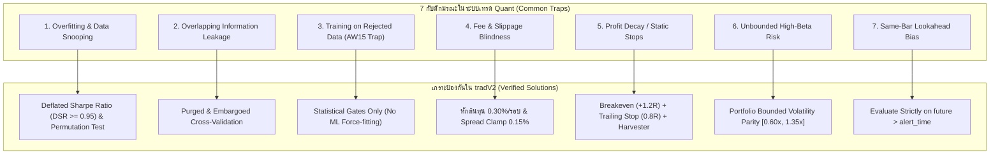

# คลังงานวิจัยและบทเรียนระบบเทรดเชิงปริมาณระดับโลก (Global Quantitative Research Compendium)
**เวอร์ชัน:** 1.0 (ตุลาคม 2026)  
**วัตถุประสงค์:** รวบรวมงานวิจัย โมเดล Open-Source (GitHub / Hugging Face) ทฤษฎีสถาบัน และแผนผังป้องกันกับดัก (Anti-Patterns Matrix) เพื่อใช้เป็นแหล่งอ้างอิงในการต่อยอดและป้องกันไม่ให้ระบบวนกลับมาเจอปัญหาเดิม  
**ที่จัดเก็บ:** `.agents/knowledge/QUANT_RESEARCH_COMPENDIUM.md`

---

## 1. การสำรวจโครงการ Open-Source ชั้นนำระดับโลก (GitHub Top Quant Frameworks)

จากการสำรวจสถาปัตยกรรมระบบเทรดระดับสถาบันบน GitHub โครงการที่ทรงอิทธิพลและเกี่ยวข้องกับระบบของเรามากที่สุดประกอบด้วย 4 เสาหลัก:

### 1.1 NautilusTrader (`nautechsystems/nautilus_trader`)
* **ลิงก์:** [https://github.com/nautechsystems/nautilus_trader](https://github.com/nautechsystems/nautilus_trader)
* **สถาปัตยกรรม:** Rust Core + Python Control Plane (Event-Driven Nanosecond Precision)
* **บทเรียนสำคัญที่นำมาปรับใช้ได้:**
  * **Zero Code Divergence:** กลยุทธ์ที่ใช้ในการ Backtest และการเทรดจริงบน Live ต้องเป็นชิ้นโค้ดเดียวกัน 100% ป้องกันข้อผิดพลาดที่เกิดจากการเขียนตรรกะซ้ำซ้อนสองเวอร์ชัน
  * **Event-Driven State Engine:** การประมวลผลออเดอร์ต้องแยกสถานะคำสั่งอย่างชัดเจน (`SUBMITTED`, `ACCEPTED`, `TRIGGERED`, `FILLED`, `CANCELLED`) เพื่อไม่ให้เกิดคำสั่งค้างบนกระดาน

### 1.2 Microsoft Qlib (`microsoft/qlib`)
* **ลิงก์:** [https://github.com/microsoft/qlib](https://github.com/microsoft/qlib)
* **สถาปัตยกรรม:** AI-oriented quantitative investment platform (Python / C++)
* **บทเรียนสำคัญที่นำมาปรับใช้ได้:**
  * **Alpha158 Factor Mining:** การสกัดสัญญาณอัลฟ่าไม่ควรดูแค่อินดิเคเตอร์เดี่ยว แต่ควรใช้ชุดตัวดำเนินการทางคณิตศาสตร์แบบ Rolling (เช่น `ts_rank`, `ts_corr`, `ts_slope`, `signed_power`) ซึ่งระบบเราได้นำมาบรรจุใน [`infrastructure/council/quantum_lab.py`](file:///e:/5-8-69/tradV2/infrastructure/council/quantum_lab.py) เรียบร้อยแล้ว
  * **Automated Hypothesis Evolution (RD-Agent):** การให้ Agent ค้นหาและกลายพันธุ์สมมติฐานทางคณิตศาสตร์อย่างเป็นระบบพร้อมบันทึก Research Journal

### 1.3 Hummingbot (`hummingbot/hummingbot`)
* **ลิงก์:** [https://github.com/hummingbot/hummingbot](https://github.com/hummingbot/hummingbot)
* **สถาปัตยกรรม:** Cython/Python Crypto Market Making & Arbitrage Gateway
* **บทเรียนสำคัญที่นำมาปรับใช้ได้:**
  * **Orderbook Microstructure & Imbalance:** การสังเกตแรงซื้อขายฝั่ง Bid vs Ask แบบเรียลไทม์ และสัดส่วน Volume Imbalance เพื่อหลีกเลี่ยงการโดน Toxic Flow กลืน
  * **Gateway Connector Separation:** แยกการเชื่อมต่อ Network Layer และ Exchange Protocols ออกจาก Strategy Logic

### 1.4 QuantConnect LEAN (`QuantConnect/Lean`)
* **ลิงก์:** [https://github.com/QuantConnect/Lean](https://github.com/QuantConnect/Lean)
* **สถาปัตยกรรม:** Modular Event-driven institutional backtesting & live engine (C# / Python)
* **บทเรียนสำคัญที่นำมาปรับใช้ได้:**
  * **Universe Selection & Coarse/Fine Filtering:** การคัดเลือกเหรียญเข้าพอร์ตต้องมีเกณฑ์คัดกรองสภาพคล่องและ Spread อย่างเข้มงวด ไม่เทรดเหรียญที่สภาพคล่องต่ำเพราะจะถูก Slippage กัดกิน

---

## 2. การสำรวจโมเดล AI / Deep Learning บน Hugging Face (Financial Time-Series Foundation Models)

| โมเดล / สถาปัตยกรรม | ผู้พัฒนา & แหล่งอ้างอิง | จุดเด่นทางเทคนิค | คำเตือนและข้อควรระวัง (Do's & Don'ts) |
| :--- | :--- | :--- | :--- |
| **Amazon Chronos** | Amazon Web Services ([`amazon/chronos-t5`](https://huggingface.co/amazon/chronos-t5-base)) | แปลง Time-Series เป็น Token แบบภาษาธรรมชาติ ให้ผลลัพธ์การพยากรณ์เชิงความน่าจะเป็น (Probabilistic Forecasting) | ✅ **ใช้สำหรับ:** ประเมิน Fat-Tailed Risk, VaR, และช่วงการแกว่งตัวของ Volatility<br>❌ **ห้ามใช้:** ทำนายราคาปิดแท่งเทียนตรงๆ |
| **Google TimesFM** | Google Research ([`google/timesfm-1.0-200m`](https://huggingface.co/google/timesfm-1.0-200m)) | Decoder-only attention foundation model ประมวลผล time-series patches แบบ Autoregressive | ✅ **ใช้สำหรับ:** คาดการณ์แนวโน้มความผันผวนระยะกลาง-ยาว (Multi-horizon Volatility)<br>❌ **ห้ามใช้:** สัญญาณเข้าซื้อระดับ High Frequency |
| **PatchTST** | IBM Granite / Academic ([Hugging Face Model Hub](https://huggingface.co/models?search=patchtst)) | Sub-series patching + Channel-independent Transformer ออกแบบมาเพื่อรับมือข้อมูลที่มี Signal-to-Noise ต่ำ | ✅ **ใช้สำหรับ:** สกัด Local Semantic Pattern ของแท่งเทียน M15<br>❌ **ห้ามใช้:** ฝึกสอนโดยไม่มีการทำ Purged Cross-Validation |
| **FinGPT / FinBERT** | AI4Finance Foundation ([`FinGPT`](https://huggingface.co/FinGPT)) | Financial LLM สกัด Sentiment ข่าวสาร Macro และคริปโต | ✅ **ใช้สำหรับ:** เป็นตัวกรอง Veto ฝั่ง Macro และตรวจจับข่าวด่วนเชิงลบ<br>❌ **ห้ามใช้:** เป็นตัวยิงคำสั่งหลักโดยไม่มี Technical Confirmation |

---

## 3. แผนผังป้องกันกับดักทางการเทรดเชิงปริมาณ (The "Never-Repeat" Anti-Patterns Matrix)

ตารางนี้คือ **"วัคซีนป้องกันความล้มเหลว"** เพื่อให้แน่ใจว่าทั้งมนุษย์และ AI Agent ในอนาคตจะไม่วนกลับมาทำข้อผิดพลาดเดิมที่เคยเกิดขึ้นในวงการ Quant:



### รายละเอียดกับดักและมาตรการป้องกัน:

1. **กับดักที่ 1: Overfitting & Data Snooping (การปรับแต่งสมการจนหลอกตัวเอง)**
   * *อาการ:* นำอินดิเคเตอร์มาต่อกันหลายๆ ตัว ปรับจูนค่าจนผลในอดีตชนะ 80%+ แต่พอเปิดเทรดจริงกลับเจ๊งยับ
   * *ทฤษฎีอ้างอิง:* David H. Bailey & Marcos López de Prado (2014) *The Probability of Backtest Overfitting*
   * *กฎป้องกันในระบบ:* ห้ามรับกลยุทธ์ใหม่เว้นแต่จะผ่าน **Deflated Sharpe Ratio (DSR $\ge 0.95$)** และ **Monte Carlo Permutation Test ($p < 0.05$)** เพื่อหักล้างจำนวนครั้งที่ทดลอง (Number of Trials)

2. **กับดักที่ 2: Overlapping Label Leakage (ข้อมูลอนาคตรั่วไหลข้ามแท่ง)**
   * *อาการ:* การแบ่ง Train/Test แบบสุ่มทั่วไป (Standard K-Fold) ทำให้แท่งเทียนที่ถือข้ามคาบเวลาส่งข้อมูลผลลัพธ์รั่วเข้าชุดฝึกสอน
   * *ทฤษฎีอ้างอิง:* Marcos López de Prado (2018) *Advances in Financial Machine Learning*, Chapter 7 (Purged K-Fold)
   * *กฎป้องกันในระบบ:* ต้องใช้ **Purged & Embargoed CV** โดยเว้นระยะห่างเท่ากับเวลาถือครองสูงสุด (`max_hold_bars`) ก่อนเริ่มชุดทดสอบ

3. **กับดักที่ 3: Training on Rejected Candidates (บทเรียนตรงจาก AW15 ในระบบเรา)**
   * *อาการ:* พยายามนำสัญญาณที่ระบบเดิมคัดทิ้ง (Rejected Candidates) มาฝึกสอน Machine Learning เพื่อหวังขยายความครอบคลุม ส่งผลให้ได้โมเดลขยะที่ Win Rate ต่ำเตี้ย (~33%)
   * *กฎป้องกันในระบบ:* **ห้ามยัด ML เข้าไปในสัญญาณที่ขาด Organic Edge** ให้คงสัญญาณที่มีตัวอย่างน้อยไว้ที่ **Statistical Gate แบบดั้งเดิม** (คงสถานะ Option A ในข้อ 1 ของ `AGENTS.md`)

4. **กับดักที่ 4: Fee & Slippage Blindness (การมองข้ามต้นทุนแฝง)**
   * *อาการ:* โมเดลทำกำไรเฉลี่ยต่อไม้ได้ +0.15% แต่ต้องจ่ายค่าธรรมเนียม Taker Fee และ Slippage รอบละ 0.30% ทำให้พอร์ตขาดทุนสะสม
   * *กฎป้องกันในระบบ:* ทุกการทดสอบต้องหักต้นทุนขั้นต่ำ **0.30% Roundtrip** เสมอ และในการเทรดจริงต้องมีตัวกรอง `max_allowed_spread_pct = 0.15%` หากสเปรดกว้างให้ปฏิเสธการเข้าทันที

5. **กับดักที่ 5: Profit Decay (ปล่อยให้กำไรก้อนโตกลายเป็นขาดทุน)**
   * *อาการ:* เหรียญวิ่งขึ้นไปบวกแรง (+3R ถึง +10R) แต่ไม่มีระบบกันทุน ทำให้ราคาย้อนกลับมาชน Stop Loss เต็มไม้
   * *กฎป้องกันในระบบ:* กลไกบันได 3 ขั้น: **Breakeven Stop (+1.2R)** $\rightarrow$ **Trailing Stop (+2.0R ระยะ 0.8R)** $\rightarrow$ **Profit Harvester (+3.0R ระยะ 0.4R)**

6. **กับดักที่ 6: Unbounded High-Beta Risk (การถูกเหรียญซิ่งครอบงำพอร์ต)**
   * *อาการ:* วางเงิน 5% เท่ากันทุกเหรียญ แต่เหรียญซิ่งมี Stop Loss ห่าง 3.6% ในขณะที่เหรียญใหญ่ห่าง 1.2% ทำให้เวลาแพ้เหรียญซิ่งกินเงินพอร์ตเป็น 3 เท่า
   * *ทฤษฎีอ้างอิง:* Edward Qian (2005) *Risk Parity Portfolios*, PanAgora Asset Management
   * *กฎป้องกันในระบบ:* **Portfolio Bounded Volatility Parity** ปรับสเกลขนาดไม้ตาม Inverse Volatility ในกรอบความปลอดภัย $[0.60x, 1.35x]$

7. **กับดักที่ 7: Same-Bar Lookahead Bias (การโกงราคาในแท่งเทียนเดียวกัน)**
   * *อาการ:* แบ็กเทสต์สมมติว่าราคาไปแตะ Take Profit ก่อนที่จะลงมาชน Stop Loss ในแท่งเทียนเดียวกันที่มีทั้งจุดสูงสุดและต่ำสุด
   * *กฎป้องกันในระบบ:* โค้ดใน [`alerts/reporting.py`](file:///e:/5-8-69/tradV2/alerts/reporting.py) ตัดสินแบบ Conservative: หากแท่งเทียนเดียวกันแตะทั้ง TP และ SL ระบบจะตัดสินเป็น **Loss (`same_bar_stop_and_target`)** เสมอ

---

## 4. แผนที่การดึงมาประยุกต์ใช้ในอนาคต (Actionable Roadmap for QuantumLab)

```text
ห้องวิจัยคู่ขนาน (QuantumLab Shadow Engine)
│
├── [ขั้นที่ 1: Microstructure Enrichment]
│   └── ดึงแนวคิด Orderbook Imbalance จาก Hummingbot มาเพิ่มเป็น Feature คอลัมน์ที่ 29
│
├── [ขั้นที่ 2: Volatility Regime Forecasting]
│   └── ศึกษาการใช้ Amazon Chronos หรือ TimesFM ในการทำนายกรอบ Volatility Expansion
│
└── [ขั้นที่ 3: Institutional Validation Gate]
    └── ทุกสมมติฐานใหม่ต้องผ่าน Deflated Sharpe Ratio (DSR) >= 0.95 ก่อนเข้าสภา Arbiter
```
