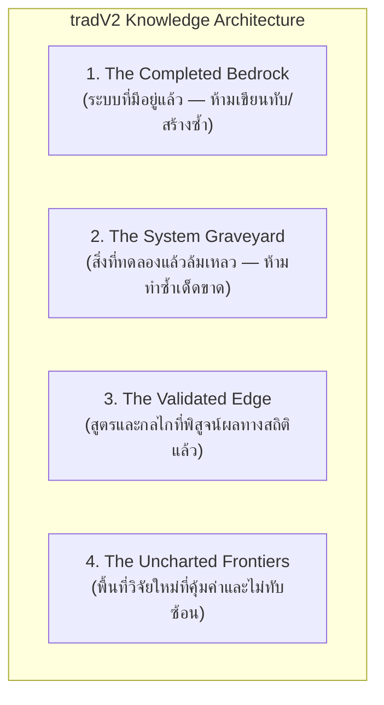
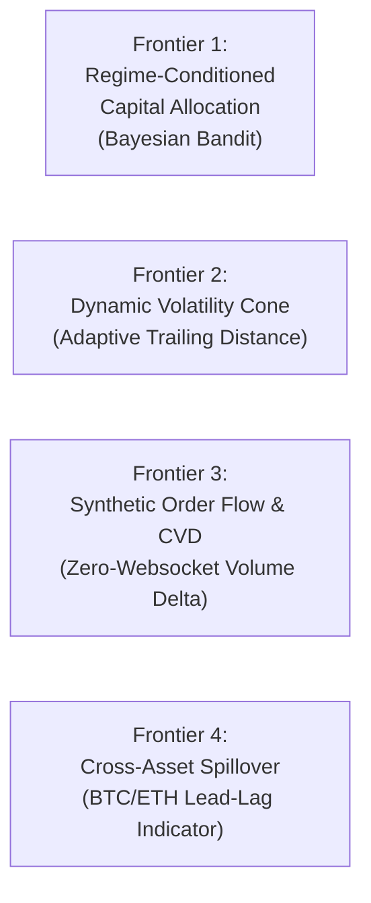

# tradV2 — Master System Research Manifest & Innovation Knowledge Base
**เวอร์ชัน:** 1.0 (ตุลาคม 2026)  
**สถานะ:** เอกสารฐานข้อมูลงานวิจัยอ้างอิงหลัก (`.agents/knowledge/SYSTEM_RESEARCH_MANIFEST.md`)  
**วัตถุประสงค์:** สรุปแผนผังองค์ความรู้ทั้งหมดของระบบ tradV2 เพื่อเป็นแนวทางแก่นักพัฒนาและ AI Agent ในอนาคต ให้สามารถต่อยอดวิจัยได้อย่างแม่นยำ **"ไม่สร้างซ้ำซ้อนกับของเดิม (No Redundancy)"** และ **"ไม่วนกลับไปทำสิ่งที่พิสูจน์แล้วว่าล้มเหลว (No Anti-Patterns)"**

---

---

## หมวดที่ 1: ระบบที่มีอยู่แล้วอย่างสมบูรณ์ (The Completed Bedrock)
*(ห้ามสร้างซ้ำซ้อน หรือเขียนโค้ดทับซ้อนสิ่งเหล่านี้)*

| ส่วนประกอบระบบ | โมดูล / ไฟล์อ้างอิง | ความสามารถที่มีอยู่แล้ว | ข้อควรปฏิบัติสำหรับอนาคต |
| :--- | :--- | :--- | :--- |
| **Live Futures Connector** | [`infrastructure/binance/client.py`](file:///e:/5-8-69/tradV2/infrastructure/binance/client.py) [`infrastructure/binance/order_manager.py`](file:///e:/5-8-69/tradV2/infrastructure/binance/order_manager.py) | ยิงคำสั่ง Binance USDT-M Futures, คำนวณ Lot Size ตาม StepSize/TickSize/MinNotional, กรอง Bid-Ask Spread $\le 0.15\%$ และ Price Drift $\le 1.05\%$ | **ห้ามเขียน Client ใหม่**, รองรับ Testnet และ Live อยู่แล้ว |
| **Dynamic Risk & Circuit Breaker** | [`infrastructure/binance/risk_manager.py`](file:///e:/5-8-69/tradV2/infrastructure/binance/risk_manager.py) | ปรับขนาดไม้ตาม % Equity, Loss Streak Throttle (แพ้ 2 ไม้ลด 50%), Circuit Breaker (แพ้ 3 ไม้พัก 6 ชม.), Daily Loss $\ge 4.0\%$ หยุดเทรด | **ห้ามสร้างระบบตัดขาดทุนซ้ำ**, ทุกคำสั่งต้องผ่านตัวนี้ |
| **Portfolio Bounded Volatility Parity** | [`infrastructure/binance/risk_manager.py`](file:///e:/5-8-69/tradV2/infrastructure/binance/risk_manager.py) | ปรับขนาดไม้ตาม Inverse Volatility Clamping ในกรอบ $[0.60x, 1.35x]$ ป้องกันความเสี่ยงเหรียญ High-Beta | **มีอยู่แล้ว 100%**, ไม่ต้องสร้าง Position Sizing อื่น |
| **Derivatives Alpha Filter** | [`infrastructure/binance/derivatives_filter.py`](file:///e:/5-8-69/tradV2/infrastructure/binance/derivatives_filter.py) | Real-time Funding Rate Squeeze Gate ($+0.04\%$ Veto BUY, $-0.03\%$ Veto SELL) และ Open Interest 1h Momentum | **มีอยู่แล้ว**, ตรวจจับฟองสบู่และ Fakeout เรียลไทม์ |
| **The 3-Tier Kinetic Escalator** | [`alerts/reporting.py`](file:///e:/5-8-69/tradV2/alerts/reporting.py) [`infrastructure/binance/order_manager.py`](file:///e:/5-8-69/tradV2/infrastructure/binance/order_manager.py) | Breakeven Stop (+1.2R) $\rightarrow$ Trailing Stop (+2.0R, 0.8R) $\rightarrow$ Profit Harvester (+3.0R, 0.4R) + Kinetic Time Stop (24 bars) | **ห้ามแก้เป็น Static TP/SL**, กลไกนี้แก้ Profit Decay สำเร็จแล้ว |
| **Safe Mathematical DSL Sandbox** | [`infrastructure/council/quantum_lab.py`](file:///e:/5-8-69/tradV2/infrastructure/council/quantum_lab.py) | รันสูตรเวกเตอร์ 28 Features (เช่น `squeeze_ratio`, `squeeze_momentum`, `ts_slope`, `ts_rank`, `pv_correlation`) ใน RAM | มีฟังก์ชันเวกเตอร์มาตรฐาน Qlib/WorldQuant ครบแล้ว |
| **GP-Tree Symbolic Mutator** | [`infrastructure/council/symbolic_mutator.py`](file:///e:/5-8-69/tradV2/infrastructure/council/symbolic_mutator.py) | Genetic Programming ใน RAM 100% (Token = 0) สกัดและผสมสายพันธุ์สูตรบนเส้น Pareto Frontier (Max Expectancy vs Min Nodes) | **มีระบบกลายพันธุ์สูตรใน RAM แล้ว**, ห้ามใช้ LLM ยิงคิดสูตรให้เปลือง Token |
| **Adversarial Stress Gauntlet** | [`tools/run_alpha_stress_gauntlet.py`](file:///e:/5-8-69/tradV2/tools/run_alpha_stress_gauntlet.py) | Replay วิกฤติ Flash Crash (Luna, FTX, Black Monday 2024), Stationary Block Bootstrap และ Friction Doubling (0.60%) | มีชุดทดสอบความทนทานก่อนปล่อยเข้า Sandbox ครบถ้วน |
| **Statistical Validation Suite** | [`domain/statistical_validation.py`](file:///e:/5-8-69/tradV2/domain/statistical_validation.py) | Deflated Sharpe Ratio (DSR $\ge 0.95$), Monte Carlo Permutation ($p < 0.05$), 99% VaR Sequence-of-Returns DD | ป้องกัน Data Snooping และภาพลวงตาตามมาตรฐาน López de Prado |
| **Global Horizon Scout** | [`infrastructure/council/global_horizon_scout.py`](file:///e:/5-8-69/tradV2/infrastructure/council/global_horizon_scout.py) [`.github/workflows/global-horizon-monthly.yml`](file:///e:/5-8-69/tradV2/.github/workflows/global-horizon-monthly.yml) | สำรวจงานวิจัยโลกอัตโนมัติเดือนละ 1 ครั้ง พร้อมวิวัฒนาการ Search Meta-Prompt ตาม Error Taxonomy | มีระบบอัปเดตองค์ความรู้ภายนอกอัตโนมัติเรียบร้อย |

---

## หมวดที่ 2: สุสานไอเดียที่ทดลองแล้วล้มเหลว (The System Graveyard — What NOT to do)
*(เคยทดสอบอย่างละเอียดแล้วและพบว่าล้มเหลว ห้ามหยิบมาทำซ้ำ)*

| สมมติฐาน / แนวคิดเดิม | ผลการพิสูจน์เชิงประจักษ์ (Empirical Evidence) | เหตุผลที่ไม่ควรทำซ้ำ | บันทึกอ้างอิง |
| :--- | :--- | :--- | :--- |
| **1. นำ Rejected Signals มาเทรน ML (AW15)** | Win Rate ตกเหลือ 33.0%, Avg Return -0.67%, ไม่มี Policy ใดรอดชีวิต | การเอาสัญญาณขยะที่ Gate กรองทิ้งมาเทรน ทำให้ ML เรียนรู้ Noise และภาพลวงตา | [Section 1 ใน `AGENTS.md`](file:///e:/5-8-69/tradV2/AGENTS.md#L5) |
| **2. Simple H1/H4 Trend Following บน Altcoins** | Backtest 465 วัน: Donchian -18.4%, EMA50/200 ไม่ Robust, ADX ยิ่งกรองยิ่งลดกำไร | เหรียญ Altcoins มี False Breakout สูง และค่าธรรมเนียม $0.30\%$ กัดกินผลตอบแทนหมด | [Section 3 ใน `AGENTS.md`](file:///e:/5-8-69/tradV2/AGENTS.md#L39) |
| **3. Fixed TP/SL โดยไม่มี Trailing & Breakeven** | ไม้ที่แพ้ถือเฉลี่ย 61.8 แท่ง โดยเคยขึ้นไปกำไรสูงสุด $+3.38\%$ ถึง $+18\%$ แต่ไหลกลับมาชน SL | ตลาดคริปโตมีความผันผวนสูง การปล่อยให้กำไรก้อนโตไหลกลับเป็นขาดทุน (Profit Decay) ทำลายพอร์ต | [Section 5 ใน `AGENTS.md`](file:///e:/5-8-69/tradV2/AGENTS.md#L62) |
| **4. Unbounded Risk Parity** | การปรับขนาดไม้ตาม Inverse Volatility แบบไม่มี Clamp ทำให้เหรียญนิ่งถูกขยาย Leverage เกินตัว | ในช่วงตลาด Black Swan เหรียญนิ่งสามารถผันผวนพุ่งกะทันหันจนเกิด Liquidation Cascade ได้ | [Section 40 ใน `AGENTS.md`](file:///e:/5-8-69/tradV2/AGENTS.md#L1415) |
| **5. ให้ LLM คิดสูตรคณิตศาสตร์แบบ String ดิบๆ** | หลุด Syntax บ่อย, สำรวจพื้นที่ได้แคบ, เปลือง Token มหาศาล | LLM ไม่เก่งการค้นหาเชิงสัญลักษณ์ในระดับลึกเท่ากับ Genetic Expression Tree ใน RAM | [Section 46 ใน `AGENTS.md`](file:///e:/5-8-69/tradV2/AGENTS.md#L1590) |
| **6. ติดตั้ง Heavy Frameworks (PyTorch, Celery, Docker)** | ทำลาย Serverless CI บน GitHub Actions ทำให้รันเทสต์ช้ากว่า 5 นาที และเสี่ยง Timeout | ระบบต้องรักษาความเร็ว Test Suite ต่ำกว่า 7 วินาที เพื่อให้รันรอบ 15 นาทีได้อย่างเสถียร | [Section 43 ใน `AGENTS.md`](file:///e:/5-8-69/tradV2/AGENTS.md#L1514) |
| **7. ใช้ AI ทำนายราคาปิดแท่งเทียนตรงๆ (Point Forecasting)** | R-squared ติดลบ, สัญญาณ Overfitting สูงจาก Brownian Noise | ควรใช้ AI พยากรณ์ **Volatility Cone หรือ Market Regime** เท่านั้น ห้ามทำนายราคาปิด | [Section 44 ใน `AGENTS.md`](file:///e:/5-8-69/tradV2/AGENTS.md#L1548) |

---

## หมวดที่ 3: สูตรและกลไกที่พิสูจน์ผลทางสถิติแล้ว (The Validated Edge)
*(แกนหลักของระบบที่ต้องรักษาความสมบูรณ์ไว้เสมอ)*

1. **กลยุทธ์หลัก Live Whitelist: `CDCVIX15` (15m CDC ActionZone + Williams VIXFix):**
   - ตรวจจับจุดกลับตัวหลังการ Panic Flush ด้วย VIXFix ร่วมกับการยืนยันสีแท่งเทียน CDC บน 5 เหรียญหลัก (`BNB, SUI, ONDO, ADA, ETH`)
   - พิสูจน์ผลลัพธ์ Net Win Rate $\ge 60.7\%$, Profit Factor $\ge 3.54$ บนข้อมูลแท่งเทียนจริง
2. **การป้องกัน Drawdown แบบทวีคูณ (Multiplicative Safety):**
   - Margin Isolated 100% (5% Equity ต่อไม้, ถือไม่เกิน 2 ไม้) สำรองสภาพคล่อง $\ge 90\%$
   - เมื่อแพ้ 2 ไม้ติดกัน จะคูณลดขนาดไม้ ($0.5x \times \text{VolParity}$) โดยอัตโนมัติ
3. **การคัดกรองอัลฟ่าเชิงสถิติเข้มงวด:**
   - DSR (Deflated Sharpe Ratio) $\ge 0.95$ (ความเชื่อมั่น 95% ว่าไม่ใช่การฟลุ๊คจากการทดสอบหลายครั้ง)
   - 5,000 Monte Carlo Sign-Permutations ($p < 0.05$)
   - แบ็กเทสต์ต้องหักต้นทุนค่าฟีและสเปรดอย่างน้อย $0.30\%$ ทุกไม้เสมอ

---

## หมวดที่ 4: แผนที่พื้นที่วิจัยใหม่ที่ไม่ทับซ้อน (The Uncharted Frontiers)
*(แนวทางต่อยอดที่คุ้มค่าสูงสุด และระบบยังไม่เคยทำมาก่อน)*

### 1. Frontier 1: Bayesian Thompson Sampling Capital Allocator (จัดสรรเงินทุนไดนามิก)
* **โจทย์:** ปัจจุบันระบบให้ `CDCVIX15` ถือสิทธิ์เทรด Live $100\%$ หากในอนาคตมีอัลฟ่าจาก QuantumLab ผ่านเกณฑ์ Sandbox ระบบยังไม่มีกลไกจัดสรรเงินทุนที่ปลอดภัย
* **แนวทางวิจัย:**
  - แบ่งพอร์ตออกเป็น **Core Portfolio (85%)** สำหรับ `CDCVIX15` และ **Explorer Portfolio (15%)** สำหรับอัลฟ่าใหม่ที่เพิ่งจบจาก Sandbox
  - ใช้ **Multi-Armed Bandit (Thompson Sampling บน Beta Distribution)**: ปรับสัดส่วนเงินทุนตามผลการเทรดจริง หากอัลฟ่าใหม่ทำกำไรได้สม่ำเสมอ พอร์ต Explorer จะค่อยๆ เติบโต แต่หากสะดุด สัดส่วนจะหดตัวกลับสู่ Core อัตโนมัติ ป้องกันไม่ให้เงินต้นเสียหาย
* **จุดเด่น:** ไม่ทับซ้อนกับระบบ Live ปัจจุบัน และเป็นสะพานเชื่อมสู่ Level 4 Autonomous Quant

### 2. Frontier 2: Dynamic Volatility Cone (ปรับระยะ Trailing ตามระดับพายุความผันผวน)
* **โจทย์:** ปัจจุบันระบบใช้ Trailing Stop ระยะคงที่ $0.8R$ ซึ่งในบางวันที่ตลาดนิ่ง ระยะนี้อาจกว้างไป แต่ในวันที่พายุข่าวเข้า (CPI, FOMC) ระยะนี้อาจแคบไปจนโดนไส้เทียนสะบัดออก
* **แนวทางวิจัย:**
  - ดึงแนวคิดจากโมเดล Time-Series Foundation (เช่น Salesforce Moirai / Chronos) มาสกัดเป็นสูตรเวกเตอร์เบาๆ:
    $$\text{Trailing Distance} = 0.8R \times \left( \frac{\text{ATR}_{15m}}{\text{EMA}(\text{ATR}, 96)} \right)^{\gamma}$$
  - เมื่อตลาดสงบ ($\text{Ratio} < 0.8$) ระยะ Trailing จะบีบกระชับเป็น $0.6R$ เพื่อล็อคกำไรเร็วขึ้น
  - เมื่อตลาดพายุเข้า ($\text{Ratio} > 1.5$) ระยะ Trailing จะขยายเป็น $1.0R - 1.2R$ เพื่อให้พื้นที่ราคาวิ่ง
* **จุดเด่น:** ประยุกต์ใช้ประโยชน์จากงานวิจัย Foundation Model โดยไม่ต้องรันโมเดล Deep Learning ขนาดยักษ์ในเครื่อง

### 3. Frontier 3: Synthetic Order Flow & CVD Proxy (แรงซื้อขายผิดปกติโดยไม่ต้องใช้ WebSocket)
* **โจทย์:** การดูแค่แท่งเทียน OHLCV ขาดข้อมูลแรงซื้อขายเชิงลึก (Order Flow / Aggressive Buyers vs Sellers) แต่การเปิด WebSocket รับ Tick Data ตลอดเวลาจะทำลายระบบ Serverless บน GitHub Actions
* **แนวทางวิจัย:**
  - สร้างตัวแปรประมาณการ **Synthetic Cumulative Volume Delta (CVD Proxy)** จากข้อมูล 15m Taker Buy Base Volume (Binance REST API มีแจกฟรี):
    $$\text{Taker Delta Ratio} = \frac{\text{Taker Buy Volume} - \text{Taker Sell Volume}}{\text{Total Volume}}$$
  - นำค่านี้ไปเพิ่มใน Feature Matrix ของ QuantumLab เพื่อตรวจจับว่าการพุ่งของราคาเป็นการกวาดซื้อจริงของสถาบัน (Aggressive Buying) หรือเป็นเพียงสภาพคล่องที่เบาบาง (Vacuum Trap)
* **จุดเด่น:** ได้ข้อมูล Order Flow ระดับสถาบันโดยกินเน็ตน้อยมากและรันบนสถาปัตยกรรมเดิมได้ทันที

### 4. Frontier 4: Cross-Asset Momentum Spillover (การส่งผ่านโมเมนตัมจาก BTC สู่ Altcoins)
* **โจทย์:** ปัจจุบันระบบวิเคราะห์สัญญาณแยกเหรียญเป็นอิสระต่อกัน (Independent per Symbol) แต่ในความเป็นจริง เมื่อ BTC หรือ ETH เบรกกรอบใหญ่ เงินจะไหลตามลำดับขั้น (Capital Rotation Sequence)
* **แนวทางวิจัย:**
  - สร้างตัวชี้วัด **Cross-Asset Lead-Lag Beta**:
    $$\text{Beta Lead} = \text{ts\_corr}(\text{Return}_{\text{Alt}}, \text{Return}_{\text{BTC}}, 16)$$
  - หาก BTC กำลังเบรกกรอบใหญ่และ $\text{Beta Lead} > 0.70$ สัญญาณซื้อของ SUI หรือ ONDO จะได้รับคะแนนความมั่นใจเพิ่มขึ้น $+10\%$
* **จุดเด่น:** ยกระดับจากการมองสัญญาณเหรียญเดี่ยวสู่การมองโครงสร้างตลาดทั้งกระดาน (Macro Market Structure)

---

## หมวดที่ 5: บัญญัติ 5 ประการสำหรับนักพัฒนาและ AI Agent ในอนาคต
1. **Never Touch Live Execution Directly:** ห้ามแก้ไข `order_manager.py`, `risk_manager.py`, หรือ `pipeline_hook.py` โดยไม่มีการพิสูจน์ผลสถิติและผ่านความเห็นชอบ
2. **Zero Dependency Bloat:** ห้ามติดตั้ง External Package หนัก (PyTorch, Docker, Celery) รักษา Test Suite ให้รันผ่านทั้งหมดภายในเวลาไม่เกิน 7 วินาที
3. **Always Deduct Friction:** การแบ็กเทสต์หรือประเมินอัลฟ่าทุกครั้ง ต้องหักค่าธรรมเนียมและสเปรดอย่างน้อย $0.30\%$ ต่อรอบเสมอ
4. **Statistical Rigor First:** ต้องผ่าน Deflated Sharpe Ratio $\ge 0.95$ และ Monte Carlo Permutation ($p < 0.05$) เท่านั้นจึงจะถือว่ามี Edge
5. **Consult the Graveyard:** ก่อนเริ่มทดลองไอเดียใหม่ ให้เปิดดู **หมวดที่ 2 (The System Graveyard)** เสมอเพื่อไม่ให้เสียเวลาและทรัพยากรไปกับสิ่งที่ไม่เวิร์ก
