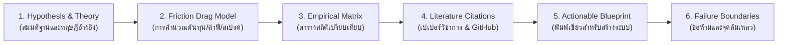

# ดัชนีสารบัญแฟ้มวิจัยการลงทุนเชิงปริมาณ (Quantitative Knowledge Dossier Registry)
**ระบบ:** Autonomous Quantitative Knowledge Protocol (AQKP)  
**สถานะ:** สารบัญกลางและข้อกำหนดมาตรฐาน (`.agents/knowledge/dossiers/KNOWLEDGE_DOSSIER_INDEX.md`)  
**วัตถุประสงค์:** ทำหน้าที่เป็นสารบัญสากลและพิมพ์เขียวมาตรฐานในการจัดเก็บ "งานวิจัยการลงทุนเชิงลึก" ที่ผ่านการพิสูจน์ทางคณิตศาสตร์ ต้นทุน และสถิติสถาบัน เพื่อให้มนุษย์และ AI Agent สามารถเรียกใช้และนำไปประกอบเป็นระบบวางแผนการลงทุนใหม่ได้ทันที

---

## 1. มาตรฐานโครงสร้างแฟ้มวิจัย (Dossier Standard Schema)
ทุกแฟ้มวิจัยรหัส `KD-XXX` จะต้องปฏิบัติตามโครงสร้าง 6 องค์ประกอบมาตรฐานอย่างเคร่งครัด:

1. **Hypothesis & Executive Summary:** สรุปโจทย์ปัญหาและข้อค้นพบหลักใน 1 ย่อหน้า
2. **Mathematical & Friction Model:** สมการคณิตศาสตร์และการคำนวณผลกระทบของต้นทุนจริง (Fee, Slippage, Turnover)
3. **Comparative Empirical Matrix:** ตารางเปรียบเทียบข้อมูลสถิติเชิงตัวเลข (Sharpe, Drawdown, Win Rate, Noise Ratio)
4. **Institutional Citations:** รายชื่องานวิจัยระดับโลก (arXiv, SSRN, AQR, Two Sigma) และโครงการ Open-Source ที่พิสูจน์แล้ว
5. **Modular Actionable Blueprint:** แนวทางและสูตรโค้ดที่สามารถหยิบไปต่อยอดสร้างระบบลงทุนใหม่ (DCA, Swing, Rebalancing)
6. **Failure Boundaries & Warnings:** กฎเหล็กและข้อห้ามเด็ดขาด (สิ่งที่ห้ามทำเพื่อไม่ให้พอร์ตแตก)

---

## 2. ทะเบียนแฟ้มวิจัยที่มีอยู่ในระบบ (Registered Knowledge Dossiers)

| รหัสแฟ้ม | ชื่อหัวข้อวิจัยเชิงปริมาณ | สถานะ | ขอบเขตการนำไปต่อยอดในอนาคต | ลิงก์เอกสารฉบับเต็ม |
| :--- | :--- | :--- | :--- | :--- |
| **KD-001** | **Multi-Timeframe Optimality & Friction Drag Analysis** *(การวิเคราะห์ความคุ้มค่าเชิงสถิติข้ามกรอบเวลา 1m ถึง 1D)* | ✅ **เสร็จสมบูรณ์** | ใช้กำหนดโครงสร้าง Timeframe สำหรับบอทเทรด Futures, กลยุทธ์ Swing 4h, และแผน Spot DCA | [อ่านฉบับเต็ม (`KD-001`)](file:///e:/5-8-69/tradV2/.agents/knowledge/dossiers/KD-001_TIMEFRAME_OPTIMALITY_MATRIX.md) |
| **KD-002** | **Dynamic Value Averaging (DVA) vs Static DCA & Momentum Rebalance** *(การวางแผนลงทุนระยะยาวแบบปรับมูลค่าตามความผันผวน)* | 📋 *รอจัดทำ* | ระบบวางแผนพอร์ตเกษียณและการออมคริปโตระยะยาว | [จองรหัส KD-002] |
| **KD-003** | **Cross-Asset Momentum Spillover & Capital Rotation Matrix** *(การคำนวณการส่งผ่านเงินทุนจาก BTC สู่ Altcoins และ Macro)* | 📋 *รอจัดทำ* | ระบบหมุนเงินทุนอัตโนมัติ (Automated Capital Rotation) | [จองรหัส KD-003] |
| **KD-004** | **Statistical Arbitrage & Cointegration Pairs Trading** *(การทำกำไรจากส่วนต่างราคาเหรียญที่มีความสัมพันธ์กัน)* | 📋 *รอจัดทำ* | กลยุทธ์ Market-Neutral ที่ไม่ง้อทิศทางตลาด (บวกได้ทั้งขาขึ้นและขาลง) | [จองรหัส KD-004] |
| **KD-005** | **Order Flow Toxicity (VPIN) & Liquidation Hunt Mechanics** *(การดักจับรอยเท้าสถาบันและการกวาดล้าง Liquidation)* | 📋 *รอจัดทำ* | สัญญาณเตือนภัยขั้นสูงก่อนเกิด Flash Crash | [จองรหัส KD-005] |

---

## 3. วิธีการสั่งให้ระบบสร้างแฟ้มวิจัยใหม่ (How to Commission a New Dossier)
เมื่อผู้ใช้ต้องการเปิดประเด็นวิจัยใหม่ ให้ระบุคำถาม เช่น:
* *"ช่วยวิจัยหัวข้อ KD-002 เรื่อง Dynamic Value Averaging เทียบกับ DCA ปกติ"*
* *"ช่วยวิจัยเปรียบเทียบการจัดพอร์ตแบบ All Weather vs Hierarchical Risk Parity ในตลาดคริปโต"*

ระบบจะทำการดึงเปเปอร์วิชาการ ค้นคว้าสถิติ คำนวณต้นทุนจริง และสกัดออกมาเป็นเอกสาร `KD-XXX` ฉบับใหม่ลงในสารบัญนี้โดยอัตโนมัติ
